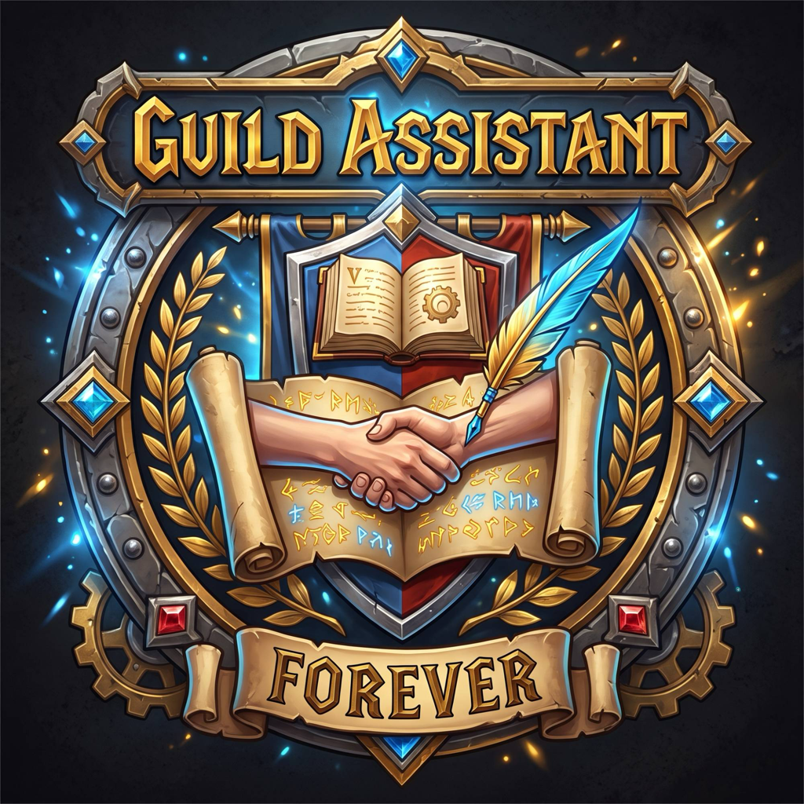

<p align="center">
  
</p>

<h1 align="center">Guild Assistant</h1>

<p align="center">
  Guild coordination and raid readiness for <b>any guild</b> on <b>World of Warcraft: Forever</b>:
  raid events, loot council, PvP seasons, layers and the guild map, in one window.
</p>

<p align="center">
  <a href="https://www.curseforge.com/wow/addons/guild-assistant"><b>Get it on CurseForge</b></a> ·
  <a href="https://github.com/Fragudev/addon-guild-assistant/releases"><b>Download from Releases</b></a> ·
  <a href="docs/USER_GUIDE.md"><b>User guide</b></a>
</p>

<p align="center">
  <a href="https://www.curseforge.com/wow/addons/guild-assistant"></a>
  <a href="LICENSE"></a>
  
  
</p>

<p align="center">
  <a href="#quick-start">Quick start</a> ·
  <a href="#what-it-is">What it is</a> ·
  <a href="#who-can-use-it">Who can use it</a> ·
  <a href="#features">Features</a> ·
  <a href="#slash-commands">Slash commands</a> ·
  <a href="#documentation">Documentation</a> ·
  <a href="#building-from-source">Building from source</a> ·
  <a href="#contributing">Contributing</a> ·
  <a href="#releasing">Releasing</a> ·
  <a href="#credits-and-licence">Credits and licence</a>
</p>

<table align="center">
  <tr>
    <td align="center" width="240"><a href="#quick-start"><b>Play</b></a><br>Install the addon and open it with <code>/ga</code>.</td>
    <td align="center" width="240"><a href="docs/USER_GUIDE.md#what-you-can-do-by-role"><b>Lead</b></a><br>Run events, loot council and PvP seasons.</td>
    <td align="center" width="240"><a href="#building-from-source"><b>Work on it</b></a><br>Build the addon and run the tests.</td>
  </tr>
</table>

## Quick start

1. **Install it with the CurseForge app** (search for
   [Guild Assistant](https://www.curseforge.com/wow/addons/guild-assistant)), then skip to step 3.
   **Or download** `GuildAssistant-<version>.zip` from the newest release on the
   [Releases page](https://github.com/Fragudev/addon-guild-assistant/releases), under *Assets* (not "Source code").
2. **Unzip it into the game's AddOns folder**:
   ```text
   World of Warcraft/<forever client folder>/Interface/AddOns/
   ```
   The zip already contains the `GuildAssistant` folder, so do not create it yourself.
3. **Restart the game** and make sure **Guild Assistant** is enabled in the AddOns list. Log in with a character that
   is in a guild: the chat says `Guild Assistant <version> loaded`.
4. **Click the minimap button, or type `/ga`**, to open the window. Everything is done from there.

Good to know:

- **Updating:** delete the old `GuildAssistant` folder, then unzip the new release the same way.
- **Language:** the interface follows the client: Spanish on `esES` and `esMX`, English otherwise.
- **Data:** your sheet and everything you share go to guildmates running the addon. Each guild's data is kept
  separately. What is shared and how is in [Privacy and data](docs/PRIVACY.md).
- **Something wrong?** Check [Troubleshooting](docs/USER_GUIDE.md#troubleshooting) first, then open an
  [issue](https://github.com/Fragudev/addon-guild-assistant/issues) with what you did, what you expected and the
  output of `/ga debug info`.

## What it is

Guild Assistant is a guild's own addon. It puts in one window what the guild otherwise coordinates by hand in chat
and spreadsheets: who is ready for the raid, who comes, who gets the loot, who leads the PvP ranking and which layer
the guild is on. Data is shared between members through the addon's own messages, with no server and no website:
what one officer changes reaches every member running the addon.

Values are never guessed. Each one says where it comes from: `verified` (read from the game), `declared` (typed by
the player) or `received` (from someone else), and what the game cannot tell is shown as `unknown`.

> [!NOTE]
> **Beta.** Every feature below is implemented and covered by automated tests, but most of it has not been verified
> on the game client yet: see the pending measurements in [docs/API_NOTES.md](docs/API_NOTES.md).

## Who can use it

The addon works for **any guild**. The only requirement is being in a guild: there is no faction, realm or ruleset
check.

- It **disables itself** on characters that are not in a guild and does not register its message prefix there; the
  login message says why.
- Each guild's data (roster, events, loot, PvP) is kept separately on your computer. Account settings (minimap,
  language, windows) are shared by all your characters. If you change guild during a session, the addon asks you to
  type `/reload` to load the new guild's data.
- Shared data is accepted only from guild members, and edits only from members whose role allows them.
- **Roles come from the guild rank:** guild master, co-guild master, officer, raid leader, roster, member and alt.
  The guild master (rank index 0, never matched by name) maps each rank to a role in the *Ranks* tab; a rank nobody
  mapped counts as member.

## Features

### Character sheet and readiness

- **Profile:** what the addon knows about your character, each value with its source, plus your declared role, main
  and notes; share your sheet with the guild.
- **Readiness:** a checklist per raid with a score that always shows its denominator (`1/3 met, 2 unknown`); unknown
  is never counted as met.

### Raid events

- Events created by raid leaders, the guild master and the co-guild master, shared with the guild, with a roster and assignments.
- **Attendance**, reusable **templates** and **reports**.
- **Export and import** as text, to move data between characters or back it up.

### Loot council

- Sessions tied to a raid event, opened after the encounter. The roster gets the **Loot** card to answer, and
  the council decides from the same window.

### PvP and PvP seasons

- **Kill counter** split into open world and battleground, a guild **kill ranking** and a **recent kills** feed.
- **Seasons:** missions approved by the guild master and co-guild master, a points ranking and end-of-season rewards.
- A PvP log kept for 45 days whatever the season, a "battlegrounds played" goal, bounty missions on Kill on Sight
  targets, and enemy classes and races that follow your own faction.

### Intel and Kill on Sight

- Enemy players around you are detected and shared with the guild: alerts, enemy pins on the maps and an Intel window.
- Personal Kill on Sight and ignore lists, and a guild Kill on Sight list kept by the guild master and co-guild master.

### Announcements and groups

- **Announcements** from the guild master and co-guild master, with a popup, a sidebar badge and a Home banner.
- **Groups:** post a group with the seats you need, apply to others, and get a notice when a guildmate opens one.

### Guild tools

- **Professions:** "who can craft this?" with online members first and a one-click whisper.
- **Blacklist:** a guild-wide list of players to be warned about.
- **Layers:** your current layer, the layers guildmates have shared, and layer swap requests.
- **Guild map:** guildmates who share their position, on the minimap and the world map.
- **Installed check:** the guild master and co-guild master see who runs the addon and which version.
- **Modules:** turn off the parts of the addon you don't use.

### Sync

- Changes made during an encounter, while the game blocks addon messages, wait in a queue and are sent when it ends.
  The *Home* tab and the minimap tooltip show the queue.

The full walkthrough, tab by tab and role by role, is the [user guide](docs/USER_GUIDE.md).

## Slash commands

| Command | Description |
|---|---|
| `/ga` | open the window |
| `/ga help` | the list of commands |
| `/guildassistant` | the same as `/ga` |
| `/ga intel ...` | Intel and Kill on Sight commands (`/ga intel help` lists them) |
| `/ga spy ...` | the same as `/ga intel` |

<details>
<summary><b>Diagnostics for developers</b></summary>

| Command | Description |
|---|---|
| `/ga debug ...` | `selftest`, `info`, `identity`, `roster`, `senders`, `lockdown`, `pvp`, `layer` |

</details>

## Documentation

| Document | For |
|---|---|
| [User guide](docs/USER_GUIDE.md) | players and officers |
| [Privacy and data](docs/PRIVACY.md) | what is shared, with whom |
| [Sync protocol](docs/PROTOCOL.md) | the wire format between clients |
| [Client API notes](docs/API_NOTES.md) | what the Forever client does and does not expose |

## Building from source

Lua 5.1 with [luacheck](https://github.com/lunarmodules/luacheck), [busted](https://lunarmodules.github.io/busted/),
[luacov](https://lunarmodules.github.io/luacov/) and [StyLua](https://github.com/JohnnyMorganz/StyLua).

```bash
luacheck GuildAssistant tests
busted --coverage && luacov && tools/check_coverage.sh 80
stylua --check GuildAssistant tests
tools/package.sh dev
```

Every pull request runs lint, the tests with a minimum of 80% line coverage, a StyLua format check and a package
build that verifies every file referenced by the TOC, `embeds.xml` and the icon is in the zip. Pull request titles
must follow [Conventional Commits](https://www.conventionalcommits.org/). Dependabot keeps the workflow actions up to
date. Domain logic is tested outside the game against fakes of the client API, which all goes through
`GuildAssistant/Core/Platform.lua`. Work happens on `develop`; see [Contributing](#contributing).

<details>
<summary><b>Translations</b></summary>

What the player reads goes through `L("English text")` (`GuildAssistant/Core/Locale.lua`): the code writes the English
text and `GuildAssistant/Locales/esES.lua` maps it to Spanish; a text with no entry is shown in English. Spanish is
used when the client is `esES` or `esMX`, English otherwise. Keep placeholders (`%d`, `%s`) in the same order, put one
string literal inside each `L(...)`, and never translate a value that is compared or sent (a status, a role, a command
word). A test fails when the code asks for a text the catalog does not have, when the catalog has one nothing asks
for, or when the placeholders differ.

</details>

### Project layout

```text
GuildAssistant/          Addon files (the only folder shipped in release zips)
  Core/                  Constants, platform seam, access and lockdown guards, guild identity, store
  Domain/                Profile, readiness, events, loot, permissions, reports, templates, PvP and PvP seasons,
                         layers, diagnostics
  Sync/                  Codec, protocol, inbox and outbound queue, event, loot and PvP season sync, snapshot,
                         import/export
  UI/                    Window (own widget kit in Kit/), tabs and view models
  Commands/              Slash commands
  Locales/               Translations (esES)
  Libs/                  Vendored libraries, see Libs/README.md
  Media/                 Game textures, fonts and icons
assets/                  Source artwork (not shipped), see assets/README.md
tools/                   Development helpers (image conversion, packaging, coverage gate)
tests/                   busted specs and client API stubs
docs/                    Documentation
release-notes/           Hand-written notes published with each release
.github/workflows/       CI and release automation
```

## Contributing

Bug reports and ideas are welcome as [issues](https://github.com/Fragudev/addon-guild-assistant/issues). Pull requests
are open to maintainers only. Day-to-day work lands on `develop`, directly or through short-lived branches, and `main`
only takes pull requests from `develop` approved by the owner.

## Releasing

Betas ship from `develop` and releases from `main`; only the owner can push version tags. Write the notes in
`release-notes/<tag>.md`, then push the tag. The **Release** workflow checks that the tag is on the right branch, runs
the full CI and, only if both pass, stamps the version into the TOC, zips `GuildAssistant/`, publishes a GitHub
release and uploads the zip to CurseForge.

```bash
# Beta: tag develop
git switch develop && git pull && git tag v1.2.0-beta.1 && git push origin v1.2.0-beta.1
# Release: merge develop into main through a pull request, then tag main
git switch main && git pull && git tag v1.2.0 && git push origin v1.2.0
```

Tags containing a hyphen are published as betas (a GitHub pre-release and a CurseForge beta), the rest as releases.
After a release, merge `main` back into `develop`. Only `GuildAssistant/` is shipped: `tests/` and `docs/` stay out of
the zip. If the CurseForge upload fails, run the **Release** workflow by hand with the existing tag to publish it
again.

## Credits and licence

- **Fira Sans** (Regular, Medium and SemiBold) by The Mozilla Foundation and Telefonica S.A., licensed under the SIL
  Open Font License 1.1: `GuildAssistant/Media/Fonts/` (the licence is `OFL.txt` in the same folder).
- The icons in `GuildAssistant/Media/Icons/` are our own simple shapes, drawn by `tools/make_icons.py`.
- The interface is built with the addon's own widget kit (`GuildAssistant/UI/Kit/`). No code, texture or font was
  copied from other addons.

Guild Assistant started as a fork of Nrage Assistant.

Proprietary. All rights reserved. See [LICENSE](LICENSE).
